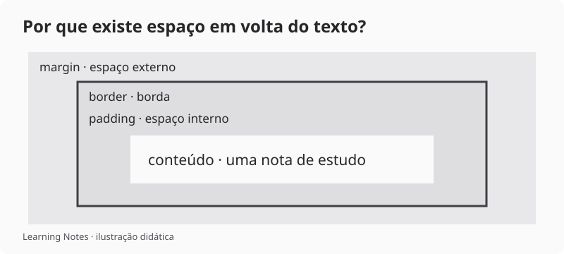

# CSS — aparência e espaço

CSS define como o HTML aparece: cores, fontes, tamanhos e distâncias. O conteúdo continua no HTML.

## Estilizando a primeira página

Coloca este bloco dentro do `head` do exemplo anterior:

```html
<style>
  * { box-sizing: border-box; }
  body {
    margin: 0;
    background: #fafafa;
    color: #27272a;
    font-family: system-ui, sans-serif;
    line-height: 1.6;
  }
  header, main {
    max-width: 48rem;
    margin-inline: auto;
    padding: 1.5rem;
  }
  h1 { font-family: Georgia, serif; }
  a { color: #3f3f46; }
  a:focus-visible { outline: 2px solid #3f3f46; outline-offset: 4px; }
  li { padding-block: 0.75rem; }
</style>
```

O seletor `body` escolhe o elemento. `color` é a propriedade; `#27272a` é seu valor. `max-width` limita a largura, e `margin-inline: auto` centraliza o bloco quando sobra espaço.

## Entendendo o espaço



*Ilustração do modelo de caixa, sem escala.*

`padding` é o espaço interno; `margin` fica fora da borda. Com `box-sizing: border-box`, a largura declarada inclui conteúdo, padding e borda. A margem continua por fora.

## Aplicação no site

Em `.frontend/.vitepress/theme/style.css`, o Learning Notes usa branco, cinza e grafite, com Georgia nos títulos de leitura. Variáveis como `--vp-c-bg` e `--vp-c-brand-1` centralizam as cores; o tema escuro redefine seus valores.

A biblioteca usa linhas com espaço entre os elementos. Isso ajuda a comparar os títulos sem colocar cada nota dentro de um cartão.

## Tenta tu

Troca o `padding` de `1.5rem` para `0` e observa o texto encostar nas bordas. Depois restaura o valor e reduz a janela: a página deve caber sem rolagem horizontal. Confere também se o link mostra um contorno ao receber foco com Tab.

Referência: [modelo de caixa na MDN](https://developer.mozilla.org/pt-BR/docs/Learn_web_development/Core/Styling_basics/Box_model).

Próximo: [fazer a busca responder com JavaScript](./03-javascript).
