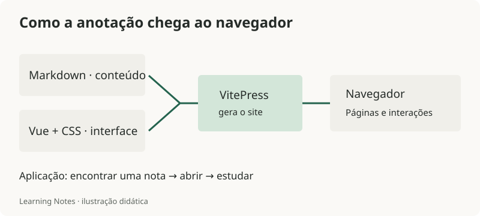

# Vue e VitePress — aplicação no Learning Notes

O objetivo do Learning Notes é guardar conhecimento e facilitar a consulta. A página inicial apresenta os assuntos; a biblioteca permite encontrar uma nota; a página de leitura mostra o conteúdo e os próximos passos.

## Das notas à página



*Diagrama da implementação; não é uma captura de tela.*

VitePress transforma Markdown em páginas usando um tema. Vue cuida dos componentes e das interações. Neste projeto, o frontend está em `.frontend/`; os textos ficam nas pastas de assuntos da raiz.

## Um primeiro componente Vue

Este exemplo é uma versão reduzida da busca, para estudar dentro de um componente `.vue`:

```vue
<script setup>
import { computed, ref } from 'vue'

const busca = ref('')
const notas = ['HTML', 'CSS', 'JavaScript']
const filtradas = computed(() => notas.filter(nota =>
  nota.toLowerCase().includes(busca.value.trim().toLowerCase())
))
</script>

<template>
  <label for="busca">Buscar nas notas</label>
  <input id="busca" v-model="busca" type="search">
  <ul>
    <li v-for="nota in filtradas" :key="nota">{{ nota }}</li>
  </ul>
  <p v-if="!filtradas.length" role="status">Nenhuma nota encontrada.</p>
</template>
```

`ref` guarda um valor reativo. `v-model` conecta esse valor ao campo. `computed` calcula as notas que combinam com a busca. `v-for` mostra cada resultado. O Vue atualiza a lista quando o valor muda.

O exemplo é intencionalmente pequeno. A versão real também trata acentos, filtros, paginação e foco ao mostrar mais resultados.

## O que foi construído e onde estudar

| Recurso visível | Conceito para aprender | Arquivo em `.frontend/.vitepress/` |
| --- | --- | --- |
| Início com índice de assuntos | Estrutura e hierarquia de conteúdo | `theme/components/LibraryHome.vue` |
| Busca e filtros da biblioteca | Estado, eventos e valores calculados | `theme/components/LibraryCatalog.vue` |
| Lista de notas disponível para busca | Preparação dos dados durante o build | `theme/notes.data.ts` |
| Cores, espaçamento e tema escuro | CSS e variáveis | `theme/style.css` |
| Navegação por assunto | Organização de links | `sidebar.ts` |
| Etapas marcadas como estudadas | Persistência local e tratamento de falhas | `theme/progress.ts` |

Para comparar com o resultado real, abre a [Biblioteca](/biblioteca) e o [início](/). Busca uma nota, troca o assunto e usa o teclado para abrir um resultado.

## Rodar e conferir

Na raiz do repositório:

```powershell
cd .frontend
npm.cmd ci
npm.cmd run docs:dev
```

Abre o endereço mostrado no terminal. Depois de uma mudança:

```powershell
npm.cmd test
npm.cmd run docs:build
npm.cmd run check:site
```

Os testes verificam comportamentos como filtros e teclado. O build gera o site; a checagem verifica links e arquivos publicados. Ainda precisa olhar a página no navegador para conferir cortes de texto e o layout no celular.

## Próximo exercício

Adiciona uma nota sobre Flexbox nesta pasta e confere se aparece ao selecionar **Frontend** na biblioteca. O carregador já busca os arquivos Markdown deste assunto; tu não precisa cadastrar cada nota manualmente.

Referências: [reatividade no Vue](https://vuejs.org/guide/essentials/reactivity-fundamentals.html) e [o que é VitePress](https://vitepress.dev/guide/what-is-vitepress).
