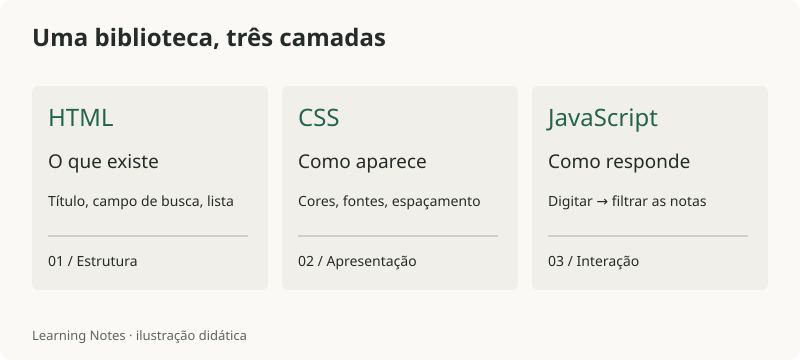

# Frontend — do HTML à biblioteca

Frontend é a parte do site que tu vê e usa no navegador. Aqui, o exemplo é o próprio **Learning Notes**: uma biblioteca para encontrar e ler anotações.

Vamos começar pequeno: um título, uma lista de notas e uma busca. Depois conectamos isso ao site real.

*Diagrama didático feito para estas notas; não é um print do site.*

## Por onde começar

| Ordem | Assunto | O que tu vai construir |
| --- | --- | --- |
| 1 | [HTML: estrutura e significado](./01-html) | Título, navegação e lista de notas |
| 2 | [CSS: aparência e espaço](./02-css) | Uma página legível no celular e no computador |
| 3 | [JavaScript: uma busca simples](./03-javascript) | Filtrar a lista enquanto digita |
| 4 | [Vue e VitePress no Learning Notes](./04-learning-notes) | Entender como os conceitos aparecem na biblioteca real |

## Ver o resultado

<a :href="withBase('/exercicios/frontend/biblioteca.html')" target="_blank" rel="noopener">Abrir a minibiblioteca funcionando (nova aba) →</a>

O exemplo é uma página independente com HTML, CSS e JavaScript. Tu pode testar a busca, usar a tecla Tab e diminuir a janela. O código completo está no arquivo, para abrir no editor e mexer.

<a :href="withBase('/exercicios/frontend/biblioteca.html')" download>Baixar o exemplo HTML</a>

No repositório, `frontend/` guarda estas notas e imagens. A pasta `.frontend/`, com ponto, continua guardando o código que constrói o site.
